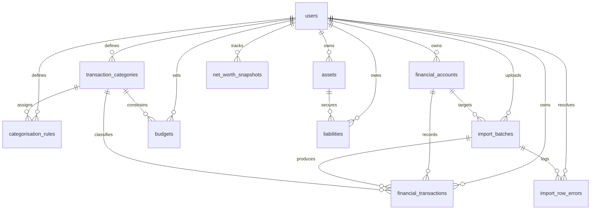

# FinPath MVP Data Model & ERD (11 Migrated Tables)

All monetary values use `NUMERIC(18, 4)` in PostgreSQL and `Decimal` in Python. MVP currency is `INR` (`CHECK (currency = 'INR')`).

## Entity-Relationship Diagram

## Key Invariants
1. **Derived Account Balances**: `financial_accounts` stores `opening_balance` and `opening_balance_date`, never `current_balance`. Current balance is derived as `opening_balance + SUM(credit) - SUM(debit)`.
2. **Account Deletion Policy**: API blocks `DELETE /accounts/{id}` (`409 Conflict`) when transactions exist unless `?confirm_delete_transactions=true` is passed, recommending soft-archive (`is_active = false`). DB FK uses `ON DELETE CASCADE` so full user deletion (`DELETE /me`) cascades cleanly.
3. **Credit Card Single Source of Truth**: Credit cards exist only in `financial_accounts` (`account_type = 'credit_card'`). `liabilities` disallows `credit_card`. Net worth counts positive account balances in assets and `abs(min(balance, 0))` in liabilities.
4. **Idempotent Fingerprints**: `financial_transactions` enforces `UNIQUE (user_id, fingerprint)` where `fingerprint = SHA256(user_id | account_id | tx_date | amount | currency | direction | description_clean | reference_number | occurrence_index)`. `occurrence_index` counts identical tuples within one import file, so same-day identical transactions are preserved while re-imports are skipped.
5. **User Isolation (RLS)**: All 10 user-scoped tables enforce `FORCE ROW LEVEL SECURITY` via non-superuser role `finpath_app` reading `app.current_user_id`.
